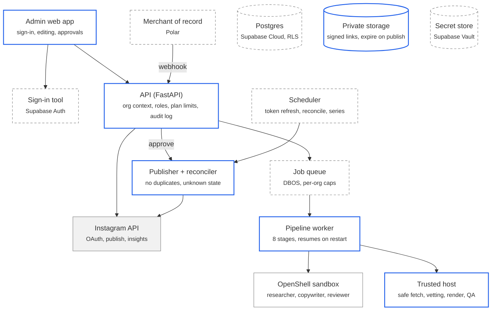
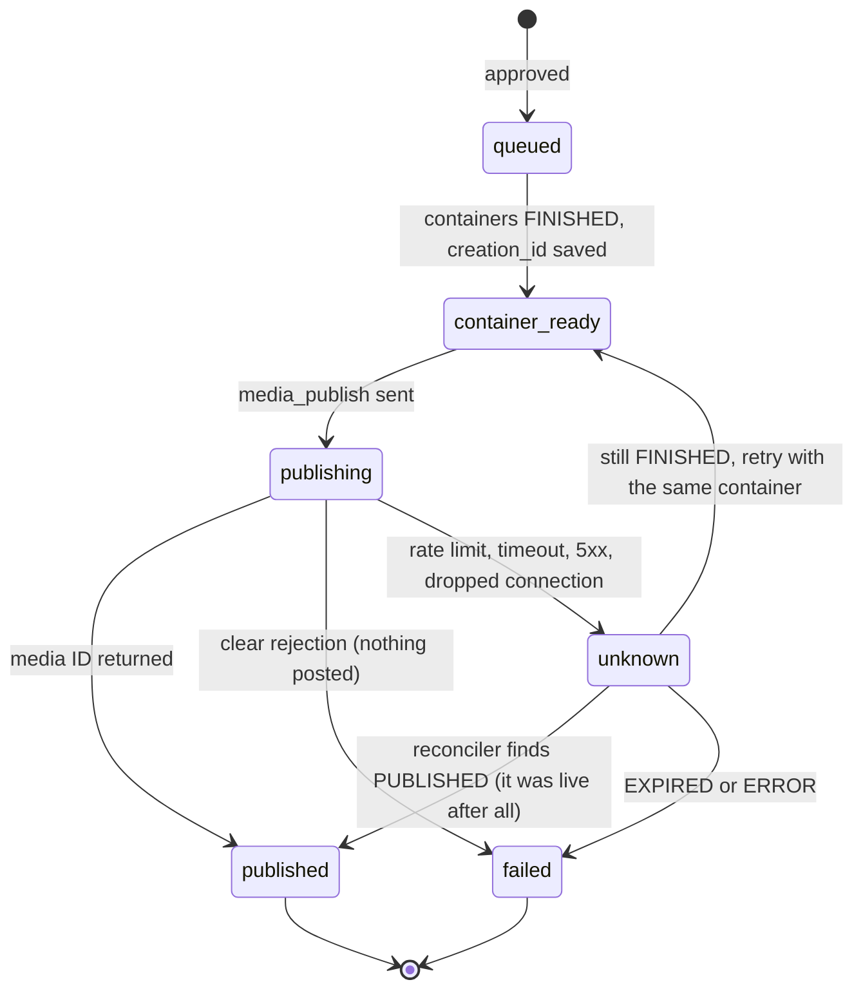

# v1 spec: path to first sale

Status: **draft**, 2026-10-08; platform decisions recorded 2026-10-29 (see [Decisions](#decisions)). The living version is the "v1 spec" tab of the product discovery doc; this file is the repo copy. Architecture and tool options are in that doc's "Platform decisions" tab; production gaps are in [`docs/HARDENING.md`](../HARDENING.md).

v1 keeps today's pipeline (FastAPI, Claude Code agents in OpenShell, HTML card templates, Next.js Admin) and hardens it so organizations can sign up, connect their own Instagram, and publish reliably. Each platform choice still sits behind an interface, so it can be swapped later without touching the pipeline.

## Path to first sale

Seven workstreams, in the confirmed order. The first three are the minimum before any external customer touches the product.

| # | Workstream | Done when | Already written up | Decided |
| --- | --- | --- | --- | --- |
| W1 | Customer accounts + their own Instagram | A new organization signs up, invites a teammate, connects its Instagram account and publishes to it; one organization can never see another's data | HARDENING SEC-2, SEC-4, PUB-5 | Supabase Auth, Postgres + RLS, Supabase Vault; Meta: testers only for now |
| W2 | Publish reliability | No duplicate or phantom posts under rate limits, timeouts or restarts; jobs survive restarts; tokens refresh before expiry | HARDENING PUB-1, PUB-3, PUB-4, REL-1 | DBOS; timed posts in v1 |
| W3 | Security basics | Sign-in required everywhere; host refuses internal URLs; agents cannot inject image URLs; slides private with signed links | HARDENING SEC-1, SEC-2, SEC-3 | — |
| W4 | Light editing + brand | Edit a slide's text, swap its photo, regenerate one slide; upload own photos (v1). Logo and colours per organization right after v1 | Discovery stories 3, 6, 9 | Story 6 is Should |
| W5 | Run it properly | Fixed domain with TLS, nightly backups with a tested restore, alerts on failed or unknown publishes | HARDENING OPS-1, OPS-2, REL-2 | Coolify; Supabase Cloud |
| W6 | Getting paid | A customer can subscribe; plan limits are enforced; terms and privacy notice published | Platform decisions: Payments | Polar; tiers with deck quota; 14-day trial. Prices pending cost per deck |
| W7 | Content quality | Official photos used when available; a fixed test set runs on every prompt change | Discovery: photo sourcing; HARDENING AGT-3 | — |

## Scope of v1

v1 is today's product made multi-customer and dependable. Anything that isn't needed to sell to the first organizations waits.

| In v1 | Not in v1 (decided, or proposed) |
| --- | --- |
| Quick mode and Brainstorm, as today | Other networks (decided: Instagram first) |
| Research → verify → copy → render → QA → review, as today | Autopilot series (paid tier, after v1; the scheduler is designed now) |
| Organizations, members, four roles | Full Canva-style editor (proposed: light editing only) |
| Each organization connects its own Instagram | Public-institution procurement and Korean tax invoices (proposed: after business registration) |
| Approve, override with reason, publish now or at a chosen time (story 10) | Multiple languages per post (proposed) |
| Edit slide text, swap photo, regenerate one slide, photo upload; every fact shows its source (stories 2, 3, 9) | Self-hosted image generation (proposed: keep the labelled stock set) |
| Honest publish status, no duplicates, retries, token refresh | |
| Subscriptions through Polar; 14-day full trial | Right after v1 (Should): brand kit, manager approval flow, per-post saves and reach (stories 6, 7, 11) |
| Monitoring, backups, alerts | Later: article-to-cards fast path (story 8) |

## Architecture

The agents, sandbox and renderer stay. What changes is around them: the API learns about organizations and roles, jobs move onto a durable queue, publishing gets its own state machine, and tokens, files and money each get a proper home.



Grey solid = kept as is · blue = hardened · dashed = new · grey fill = outside service. The API, workers and publisher all use the three data stores at the bottom.

Approving a Deck hands a post to the publisher; the scheduler refreshes tokens and settles posts whose outcome is unknown. Only the publisher and the Instagram connect flow ever hold an organization's Instagram token.

## Data model

Every table carries `org_id`, and today's `Job` JSON document stays as-is in a `jsonb` column so the pipeline code barely changes. Postgres with shared tables and row-level security (decided 2026-10-29).

| Table | Key columns | Notes |
| --- | --- | --- |
| `orgs` | id, name, plan, time_zone (default Asia/Seoul), is_pilot, instagram_account_limit, created_at | The tenant. `is_pilot` is set by an operator only |
| `members` | org_id, user_id, role (viewer, editor, approver, admin), invited_by, created_at | `user_id` is Supabase Auth's `auth.uid()` |
| `instagram_accounts` | id, org_id, ig_user_id, username, account_type, token_ref, token_expires_at, status (connected, expiring, revoked, disconnected), connected_by | Token itself lives in Supabase Vault; `token_ref` points to it. `orgs.is_pilot` and `orgs.instagram_account_limit` gate connecting (#15) |
| `brand_kits` | id, org_id, name, logo_asset_id, colors (jsonb), fonts, tone_words | One default per org in v1 |
| `assets` | id, org_id, kind (upload, official, stock, ai), storage_key, licence, credit, source_url, rights_confirmed_by | Private storage; never shared across orgs |
| `materials` | id, org_id, created_at, doc (jsonb = `Material`: kind link/file/note, name, extracted text capped at 20k chars) | Source material (#20); file private under `<org_id>/<id>/`; append-only for the API role |
| `jobs` | id, org_id, created_by, status, source (quick, brainstorm), doc (jsonb = today's `Job`), created_at, updated_at | Indexed on (org_id, status) |
| `job_stages` | job_id, stage, state, attempt, started_at, finished_at, output_ref, error | Lets a restarted worker resume at the right stage |
| `brainstorms` | id, org_id, doc (jsonb = today's `Brainstorm`) | As today, plus org_id |
| `deck_versions` | id, job_id, version, slides (jsonb), caption, edited_by, created_at | Every edit is a new version; approve pins one |
| `posts` | id, org_id, job_id, deck_version, instagram_account_id (+ ig_user_id, username snapshot), mode, state, caption, creation_id, container_created_at, media_id, permalink, attempts, reconcile_attempts, progress, approved_by, scheduled_at, unknown_since, next_check_at, alerted_at, published_at, finished_at, last_error | The publish state machine (below), #21. One open Post per Job and one live post of a Deck version per Instagram account (unique indexes). The Job no longer carries publish fields |
| `audit_events` | id, org_id, actor, action, target, detail (jsonb), at | Append-only: approvals, overrides, edits, connects |
| `policy_events` | id, org_id, job_id, sandbox, binary, host, request, result, at | Sandbox denials, as today |
| `subscriptions` | org_id, provider (polar), external_id, plan, status, current_period_end | Written only by the payments webhook |
| `usage` | org_id, period, jobs_run, posts_published, agent_cost_usd | Plan limits and cost tracking |

**Isolation rule:** the API connects as a role without RLS bypass and sets `app.org_id` per request; every policy is `org_id = current_setting('app.org_id')::uuid`. Only migrations and the payments webhook use a privileged role.

## Key flows

Two flows carry v1: getting a customer connected, and taking one job from request to a live post.

**Onboarding and Instagram connect**

1. A person signs up through Supabase Auth; the API creates an `orgs` row and makes them `admin`.
2. The admin invites teammates by email and gives each a role (viewer, editor, approver, admin).
3. The admin clicks **Connect Instagram**. The API redirects to Instagram's authorization page asking for `instagram_business_basic` and `instagram_business_content_publish`, with a signed `state` that carries the org and a one-time nonce.
4. Instagram redirects back with a code. The API exchanges it for a short-lived token (1 hour), then for a long-lived token (60 days).
5. The API reads the account (`/me`: user ID, username, account type). A personal account is refused with a guide to switching to Business or Creator.
6. The token goes into the secret store; `social_accounts` gets the reference and the expiry; an audit event is written.
7. The admin sets the brand kit (logo, colours, fonts). Until then the default What's On Korea style is used.

**One job, request to live post**

1. An editor submits a request (Quick) or generates from a Brainstorm board. The API checks the plan's job limit, writes `jobs` with status `QUEUED`, and enqueues it.
2. A worker claims the job and runs the stages in order, recording each in `job_stages`: research (sandbox) → verify links (host) → vet photos (host) → copy (sandbox) → attach stock (host) → render (host) → visual QA (host) → review (sandbox).
3. If the worker dies, another worker picks the job up and skips stages already marked done.
4. The job reaches `READY_FOR_REVIEW`. Editors can change slide text or photos; each change re-renders that slide and saves a new `deck_versions` row.
5. An approver approves a specific version (overrides of blocking issues need a reason). The API creates a `posts` row in state `queued` and an audit event.
6. The publisher takes the post through the state machine below and updates the job when the post is live.

## Publish state machine

Every post moves through six states saved in `posts.state`. Only `published` and `failed` are final; `unknown` is the state the 2026-10-07 incident needed (Instagram returned "Application request limit reached" on `media_publish`, but the post went live).



| Rule | Why |
| --- | --- |
| `creation_id` is saved before `media_publish` is called, and every retry reuses it | A container can be published once, so a retry can't make a second post |
| Rate-limit codes (4, 17, 32, 613), timeouts, 5xx and dropped connections go to `unknown`, never `failed` | Instagram has published despite returning an error |
| While a post is `unknown`, Approve is locked and the Admin shows "Checking Instagram…" | Stops the operator from posting twice |
| The reconciler checks the container's `status_code` with backoff; after 30 minutes it alerts a person, who can resolve it by hand (logged) | Rate limits can block the check itself |
| A restart finds `publishing` posts and moves them to `unknown` | Today's recovery marks them failed even if they went live |
| Containers expire 24 hours after creation, so scheduled posts build them shortly before posting | Meta's rule |
| "Nothing was posted" is shown only for `failed` | Honest status |

## API

Today's 16 routes stay, scoped to the caller's organization; v1 adds accounts, Instagram connect, editing, posts, billing and audit. Every route needs a signed-in member except `/health`, the Instagram callback and the payments webhook (which verify their own signatures).

| Method + path | Minimum role | What it does | Change from today |
| --- | --- | --- | --- |
| `GET /me` | any member | User, organizations, role in each | New |
| `POST /orgs` | signed in | Create an organization; caller becomes admin | New |
| `GET /orgs/current/members` | viewer | List Members and Roles | New |
| `POST /orgs/current/members` · `PATCH` · `DELETE /orgs/current/members/{user}` | admin | Invite (email + role), change role, remove; never the last admin | New |
| `GET` · `DELETE /orgs/current/invitations/{id}` | admin | Pending invitations; withdraw one | New |
| `POST /invitations/accept` | signed in | Join the inviting organization (token + matching email) | New |
| `POST /instagram-accounts/connect` | admin | Instagram's authorization URL with a signed, single-use state (JSON, so the Admin can send its Bearer token) | New |
| `GET /instagram-accounts/callback` | (state check) | Exchange code → long-lived token → Vault → redirect to `ADMIN_URL/instagram` | New |
| `GET /instagram-accounts` · `GET /instagram-accounts/connection` · `DELETE /instagram-accounts/{id}` | viewer · viewer · admin | Connected accounts with expiry; whether this Organization may connect (Pilot, limit) and why not; disconnect | New (replaces the token in `.env` once #21 lands) |
| `GET` · `PUT /brand-kit` | viewer · admin | Read or set logo, colours, fonts, tone | New |
| `POST /assets` · `GET /assets/{id}/url` | editor · viewer | Upload a photo (rights confirmation required); short-lived signed view URL | New |
| `POST /materials` · `POST /materials/files` · `GET /materials/{id}` | editor · viewer | Attach Source material (link fetched on the host via safe_fetch, or note; or a PDF/image/text file); read its extracted text | New (#20) |
| `POST /jobs` · `GET /jobs` · `GET /jobs/{id}` · `GET /jobs/{id}/events` | editor · viewer | Create (with `material_ids`), list, read, live updates | Scoped to org; plan limit checked on create |
| `PATCH /jobs/{id}/slides/{n}` | editor | Change text or photo of one slide → re-render → new version | New |
| `POST /jobs/{id}/slides/{n}/regenerate` | editor | Re-run copy for one slide only | New |
| `POST /jobs/{id}/approve` | approver | Body: version, caption, `account_id` (preselected when the Organization has one), override reason if blocked → creates a post | Was: any token holder; now pins a version and needs the approver role |
| `POST /jobs/{id}/reject` | approver | Reject with reason | Role added |
| `GET /posts?job_id=` · `GET /posts/{id}` | viewer | Posts (newest first); publish state, attempts, permalink | New (#21) |
| `POST /posts/{id}/resolve` | approver | For `unknown` posts: "I checked Instagram: posted / not posted" (logged) | New |
| `/brainstorms/*` (5 routes) | editor | Brainstorm, as today | Scoped to org |
| `GET /metrics` | viewer | Insights for this org's account | Per org: the Organization's first connected account (#21) |
| `GET /policy-events` · `GET /audit` | admin | Sandbox log; audit trail | Audit is new |
| `POST /billing/checkout` · `GET /billing` | admin | Start a subscription at Polar; show plan and usage | New |
| `POST /webhooks/billing` | (signature) | Subscription created / renewed / cancelled → `subscriptions` | New |
| `POST /reset` | — | Demo reset | Removed outside development |

## Pseudocode

Python-flavoured, close to how it would land in `backend/app`. Classes marked as interfaces are where a platform choice plugs in; the decided implementation is named in each comment.

### 1 · Organization context and roles

Every request resolves who is calling and which organization they act for, before any handler runs; the database only ever sees that organization's rows.

```python
# Interfaces (implementation: Supabase Auth JWT, verified against its JWKS)
class Identity(Protocol):
    def verify(self, request) -> User | None: ...          # session cookie or bearer token

ROLE_RANK = {"viewer": 0, "editor": 1, "approver": 2, "admin": 3}

@dataclass
class Ctx:
    user: User
    org_id: UUID
    role: str

async def context(request, identity: Identity, db) -> Ctx:
    user = identity.verify(request)
    if user is None:
        raise HTTP(401, "sign in required")
    org_id = request.headers.get("X-Org-Id") or user.default_org_id
    member = await db.fetch_one(
        "select role from members where org_id=$1 and user_id=$2", org_id, user.id)
    if member is None:
        raise HTTP(403, "not a member of this organization")
    return Ctx(user, org_id, member.role)

def require(min_role: str):
    def dep(ctx: Ctx = Depends(context)) -> Ctx:
        if ROLE_RANK[ctx.role] < ROLE_RANK[min_role]:
            raise HTTP(403, f"{min_role} role required")
        return ctx
    return dep

@asynccontextmanager
async def tenant_tx(db, ctx: Ctx):
    # One transaction per request; row-level security reads app.org_id (if RLS is picked).
    async with db.transaction() as tx:
        await tx.execute("select set_config('app.org_id', $1, true)", str(ctx.org_id))
        yield tx

# Usage
@app.post("/jobs/{job_id}/approve")
async def approve(job_id, body: ApproveBody, ctx=Depends(require("approver"))):
    async with tenant_tx(db, ctx) as tx:
        ...                                            # see section 4 and the approve flow
```

### 2 · Instagram connect and token refresh

Each organization authorises its own professional account; tokens never touch the database in plain text and are refreshed well before their 60-day expiry. Endpoint paths follow Meta's Business Login docs and are re-checked during the build. Built in #15 as `backend/app/instagram_accounts.py` (routes under `/instagram-accounts`, table `instagram_accounts`); the sketch below is the original plan.

```python
SCOPES = ["instagram_business_basic", "instagram_business_content_publish"]

class SecretStore(Protocol):            # implementation: Supabase Vault
    async def put(self, key: str, value: str) -> str: ...      # returns a reference
    async def get(self, ref: str) -> str: ...
    async def delete(self, ref: str) -> None: ...

@app.get("/social/instagram/connect")
async def connect(ctx=Depends(require("admin"))):
    state = sign({"org": ctx.org_id, "user": ctx.user.id, "nonce": new_nonce()}, ttl=600)
    return redirect(INSTAGRAM_AUTHORIZE_URL, client_id=APP_ID, redirect_uri=CALLBACK_URL,
                    response_type="code", scope=",".join(SCOPES), state=state)

@app.get("/social/instagram/callback")
async def callback(code: str, state: str):
    claims = verify_signature(state)                  # rejects expired, forged or reused state
    consume_nonce(claims["nonce"])
    short = await ig.exchange_code(code, redirect_uri=CALLBACK_URL)          # valid 1 hour
    long = await ig.exchange_long_lived(short.access_token)                   # valid 60 days
    me = await ig.get("/me", fields="user_id,username,account_type", token=long.access_token)
    if me.account_type not in ("BUSINESS", "MEDIA_CREATOR"):     # exact values re-checked against Meta docs
        return redirect(ADMIN_URL + "/settings/instagram?error=personal_account")
    ref = await secrets.put(f"org/{claims['org']}/ig/{me.user_id}", long.access_token)
    async with system_tx(db, org_id=claims["org"]) as tx:
        await tx.upsert("social_accounts", key=("org_id", "ig_user_id"),
                        org_id=claims["org"], platform="instagram", ig_user_id=me.user_id,
                        username=me.username, token_ref=ref, status="connected",
                        token_expires_at=now() + timedelta(seconds=long.expires_in))
        await audit(tx, claims["user"], "instagram.connected", me.username)
    return redirect(ADMIN_URL + "/settings/instagram?connected=1")

# Runs daily (DBOS scheduled workflow). Meta allows refresh once a token is >= 24 h old and unexpired.
async def refresh_tokens():
    for acct in await db.all_orgs_fetch(
            "select * from social_accounts where status='connected' "
            "and token_expires_at < now() + interval '14 days'"):
        try:
            token = await secrets.get(acct.token_ref)
            new = await ig.refresh_long_lived(token)                         # +60 days from now
            await secrets.put(f"org/{acct.org_id}/ig/{acct.ig_user_id}", new.access_token)
            await db.update("social_accounts", acct.id,
                            token_expires_at=now() + timedelta(seconds=new.expires_in))
        except IgAuthError:                                                   # revoked or expired
            await db.update("social_accounts", acct.id, status="revoked")
            await alert(acct.org_id, "Instagram disconnected: reconnect to keep publishing")
        except IgRateLimited:
            continue                                                          # retry tomorrow; still >= 13 days left
```

### 3 · Durable pipeline worker

Today's `run_job` becomes a list of idempotent stages; each stage's output is saved before the next starts, so a restarted worker resumes where the last one stopped instead of failing the job.

```python
class JobQueue(Protocol):               # implementation: DBOS workflows + queues
    async def enqueue(self, job_id: str, org_id: UUID, *, concurrency_key: str) -> None: ...
    async def claim(self, worker_id: str) -> Claim | None: ...          # lease with heartbeat

STAGES = [  # name, where it runs, function  (all exist today inside orchestrator.run_job)
    ("research", "sandbox", research),        # skipped for Brainstorm jobs
    ("verify",   "host",    verify_links),
    ("photos",   "host",    vet_photos),
    ("copy",     "sandbox", write_copy),
    ("stock",    "host",    attach_stock),
    ("render",   "host",    render_slides),
    ("qa",       "host",    visual_qa),
    ("review",   "sandbox", review),
]
MAX_ATTEMPTS = {"sandbox": 2, "host": 3}

async def create_job(ctx, prompt, source, brainstorm_id=None):
    await entitlements.check(ctx.org_id, "jobs_per_month")                 # section 6
    job = new_job(org_id=ctx.org_id, created_by=ctx.user.id, prompt=prompt, source=source)
    await jobs.insert(job, status="QUEUED")
    await queue.enqueue(job.id, ctx.org_id, concurrency_key=str(ctx.org_id))  # per-org cap
    return job

async def run(job_id: str, worker_id: str):
    job = await jobs.load(job_id)
    for name, where, fn in STAGES:
        stage = await job_stages.get(job_id, name)
        if stage and stage.state == "done":
            job.apply(stage.output)                     # restore what that stage produced
            continue
        for attempt in range(stage.attempt + 1 if stage else 1, MAX_ATTEMPTS[where] + 1):
            await job_stages.upsert(job_id, name, state="running", attempt=attempt, started_at=now())
            emit(job, step=name, state="running")       # SSE, as today
            try:
                output = await with_timeout(fn(job), settings.stage_timeout[name])
                await job_stages.upsert(job_id, name, state="done", output_ref=await save(output))
                job.apply(output)
                await jobs.save(job)
                break
            except NoEvents as e:                       # nothing verifiable: stop, don't invent a deck
                return await fail(job, str(e))
            except (AgentOutputError, TimeoutError, TransientError) as e:
                await job_stages.upsert(job_id, name, state="retrying", error=str(e))
                if attempt == MAX_ATTEMPTS[where]:
                    return await fail(job, f"{name} failed after {attempt} attempts: {e}")
                await sleep(backoff(attempt))
    job.status = "READY_FOR_REVIEW"                     # never auto-reject; the approver decides
    await jobs.save(job)
    await deck_versions.insert(job.id, version=1, slides=job.deck.slides, caption=job.deck.caption)
    await usage.add(job.org_id, jobs_run=1, agent_cost_usd=job.agent_cost)
```

### 4 · Publish without duplicates, and the reconciler

The carousel container ID is saved before `media_publish` is called and reused on every retry, so a retry can only finish the same post, never create a second one. Any answer that doesn't prove the outcome moves the post to `unknown`, which locks Approve until it's settled.

```python
AMBIGUOUS_CODES = {4, 17, 32, 613}      # Meta rate-limit family: the post may or may not exist
REJECTION_CODES = {...}                 # invalid media, permissions, expired container: nothing posted

async def approve(ctx, job_id, version, caption, account_id, override_reason=None):
    job = await jobs.load(job_id)
    if job.status != "READY_FOR_REVIEW":
        raise HTTP(409, f"job is {job.status}")
    if await posts.exists_open(job_id):                  # one live publish per job
        raise HTTP(409, "already publishing")
    deck = await deck_versions.get(job_id, version)
    blocks = [i for i in job.issues_for(version) if i.severity == "block"]
    if blocks and not override_reason:
        raise HTTP(422, "blocking issues need an override reason")
    if scan_for_secrets(deck):                           # the one hard stop, as today
        raise HTTP(409, "credential-like text in the deck")
    await entitlements.check(ctx.org_id, "posts_per_month")
    post = await posts.insert(org_id=ctx.org_id, job_id=job_id, deck_version=version,
                              social_account_id=account_id, state="queued")
    await audit(ctx, "job.approved", job_id, version=version, override=override_reason)
    await queue.enqueue_publish(post.id)

async def publish(post_id):
    post = await posts.lock(post_id)                     # SELECT ... FOR UPDATE: one worker per post
    token = await secrets.get(post.account.token_ref)
    if post.state == "queued":
        urls = await storage.signed_urls(post.slide_keys, ttl=timedelta(hours=2))  # private bucket
        children = [await ig.create_child(token, u) for u in urls]
        for c in children:
            await ig.wait_finished(token, c, budget=ig_budget(post.account))      # backoff, not fixed 2 s
        creation_id = await ig.create_carousel(token, children, post.caption)
        await ig.wait_finished(token, creation_id, budget=ig_budget(post.account))
        await posts.update(post.id, state="container_ready", creation_id=creation_id)
        post.state = "container_ready"
    if post.state == "container_ready":
        await posts.update(post.id, state="publishing", attempts=post.attempts + 1)
        try:
            media_id = await ig.media_publish(token, post.creation_id)
            await mark_published(post, media_id)
        except IgError as e:
            if e.code in REJECTION_CODES:
                await posts.update(post.id, state="failed", last_error=str(e))      # nothing posted
            else:                                        # rate limit, timeout, 5xx, dropped connection
                await posts.update(post.id, state="unknown", last_error=str(e))
                await queue.enqueue_reconcile(post.id, delay=minutes(2))

async def reconcile(post_id):
    post = await posts.lock(post_id)
    if post.state != "unknown":
        return
    token = await secrets.get(post.account.token_ref)
    try:
        status = await ig.get(post.creation_id, fields="status_code", token=token)
    except IgRateLimited:
        return await queue.enqueue_reconcile(post.id, delay=backoff(post.reconcile_attempts))
    if status == "PUBLISHED":
        media_id = await ig.find_recent_media(token, created_after=post.publishing_started_at)
        await mark_published(post, media_id)            # the post was live after all
    elif status == "FINISHED":
        await posts.update(post.id, state="container_ready")    # not posted: safe to retry, same container
        await queue.enqueue_publish(post.id)
    elif status in ("EXPIRED", "ERROR"):
        await posts.update(post.id, state="failed", last_error=status)
    if post.unknown_for > minutes(30):
        await alert(post.org_id, "Publish status unknown: check Instagram before retrying")

async def mark_published(post, media_id):
    permalink = await ig.try_get(media_id, fields="permalink")   # failure here is not fatal
    await posts.update(post.id, state="published", media_id=media_id,
                       permalink=permalink, published_at=now())
    await jobs.set_status(post.job_id, "PUBLISHED", published_url=permalink)
    await usage.add(post.org_id, posts_published=1)
    await storage.expire(post.slide_keys)                      # public links stop working
```

Restart recovery changes too: a post found in `publishing` after a restart goes to `unknown` and is reconciled, never to `failed`.

### 5 · Security guards

The sandbox already contains the agents; these two guards stop the trusted host from being steered by what the agents or web pages return (HARDENING SEC-1 and the agent image-URL finding).

```python
BLOCKED_NETS = [ip_network(n) for n in (
    "127.0.0.0/8", "10.0.0.0/8", "172.16.0.0/12", "192.168.0.0/16", "169.254.0.0/16",
    "100.64.0.0/10", "0.0.0.0/8", "::1/128", "fc00::/7", "fe80::/10")]

async def safe_fetch(url: str, *, method="GET", max_bytes=15_000_000, max_redirects=3,
                     timeout=8) -> Response:
    """The only way host code may fetch a URL that came from an agent, a web page or a user."""
    for hop in range(max_redirects + 1):
        u = urlparse(url)
        if u.scheme != "https" and u.hostname not in HTTP_ALLOWED:      # e.g. openapi.seoul.go.kr:8088
            raise Unsafe("https only")
        ips = await resolve_all(u.hostname)                             # every A / AAAA record
        if not ips or any(any(ip in net for net in BLOCKED_NETS) for ip in ips):
            raise Unsafe(f"{u.hostname} resolves to a private or internal address")
        resp = await http.request(method, url, connect_to=ips[0],       # pin the vetted IP
                                  follow_redirects=False, timeout=timeout,
                                  stream=True, max_body=max_bytes)
        if resp.is_redirect:
            url = urljoin(url, resp.headers["location"])                # re-checked next hop
            continue
        return resp
    raise Unsafe("too many redirects")

# link_checker.check_url, photos._download and brainstorms.fetch_pages all switch to safe_fetch.

def sanitize_agent_deck(deck: CardDeck, catalog_ids: set[str]) -> CardDeck:
    """Agents propose words and choices, never URLs the host will load."""
    for slide in deck.slides:
        slide.image = None                         # only the host attaches images (vetted or stock)
        if slide.stock_id not in catalog_ids:
            slide.stock_id = None
        slide.source_urls = [u for u in slide.source_urls if u in deck_brief_urls(deck)]
    deck.caption = strip_control_chars(deck.caption)[:2200]   # Instagram caption limit
    return deck

# Called right after the copywriter stage, before photos and stock are attached.
```

### 6 · Slide editing, plan limits and payments, Instagram call budget

Editing reuses today's renderer one slide at a time; plan limits are read from a table the payments webhook keeps up to date; Instagram calls are rationed per account because Meta's budget scales with the account's impressions.

```python
# --- Light editing: one slide, new version, same QA as the pipeline ---
async def edit_slide(ctx, job_id, n, heading=None, body=None, asset_id=None):
    job = await jobs.load(job_id)
    if job.status != "READY_FOR_REVIEW":
        raise HTTP(409, "only Decks in review can be edited")
    latest = await deck_versions.latest(job_id)
    slides = deepcopy(latest.slides)
    if heading is not None: slides[n].heading = heading
    if body is not None:    slides[n].body = body
    if asset_id is not None:
        asset = await assets.get(ctx.org_id, asset_id)          # must belong to this org
        slides[n].image = asset.as_image()                      # licence + credit carried along
    image = await renderer.render_one(job, slides[n], brand=await brand_kits.default(ctx.org_id))
    issues = visual_qa.check_one(image, slides[n]) + scan_text(slides[n])   # overflow, PII, secrets
    v = await deck_versions.insert(job_id, version=latest.version + 1, slides=slides,
                                   caption=latest.caption, edited_by=ctx.user.id)
    await job.replace_issues_for_slide(n, issues, version=v.version)
    await audit(ctx, "slide.edited", job_id, slide=n, version=v.version)
    return v                                                     # Admin swaps in the new image

# --- Plan limits ---
PLANS = {   # plan names and limits are placeholders: free entry, base model and prices are pricing decisions
    "trial": {"jobs_per_month": None, "posts_per_month": None, "members": None, "accounts": 1},
    "paid":  {"jobs_per_month": None, "posts_per_month": None, "members": None, "accounts": None},
}

async def check(org_id, limit: str):
    sub = await subscriptions.get(org_id)
    if sub is None or sub.status not in ("active", "trialing"):
        raise HTTP(402, "subscription required")
    cap = PLANS[sub.plan][limit]
    used = await usage.current(org_id, limit)
    if cap is not None and used >= cap:
        raise HTTP(402, f"plan limit reached: {limit}")

class Billing(Protocol):              # implementation: Polar
    def verify_webhook(self, headers, body) -> Event: ...
    async def checkout_url(self, org_id, plan) -> str: ...

@app.post("/webhooks/billing")
async def billing_webhook(request):
    event = billing.verify_webhook(request.headers, await request.body())   # bad signature -> 400
    if await webhook_events.seen(event.id):                               # providers retry: dedupe
        return 200
    async with system_tx(db, org_id=event.org_id) as tx:
        await tx.upsert("subscriptions", key="org_id", org_id=event.org_id, provider=billing.name,
                        external_id=event.subscription_id, plan=event.plan,
                        status=event.status, current_period_end=event.period_end)
        await webhook_events.record(tx, event.id)
    return 200

# --- Instagram call budget (per connected account) ---
def ig_budget(account) -> Budget:
    """Read Meta's X-Business-Use-Case-Usage header after every call; slow down near the limit."""
    usage = account.last_usage                    # call_count %, estimated_time_to_regain_access
    if usage.call_count >= 90:
        return Budget(pause_until=now() + minutes(usage.estimated_time_to_regain_access or 15))
    if usage.call_count >= 75:
        return Budget(min_interval=seconds(20))
    return Budget(min_interval=seconds(3))

# Insights: one call for recent media with saves (/me/media?fields=id,insights.metric(saved)),
# cached 30 minutes per account, never inside a request handler.
```

## Acceptance checks

Each workstream is done when its checks pass in CI or in a written drill. Most are automated against a fake Instagram API, never the live account.

| WS | Check | How |
| --- | --- | --- |
| W1 | Org A's member gets 404 on every org B job, brainstorm, post, asset and account | API test across all routes with two orgs |
| W1 | A query with a missing org filter still returns no foreign rows | DB test as the API's role (row-level security, if picked) |
| W1 | Personal Instagram account refused with guidance; Business account connects, token stored outside the DB | OAuth flow test against a fake Instagram |
| W1 | Viewer can't edit, editor can't approve, approver can't invite | Role matrix test |
| W2 | Rate-limit error on `media_publish` → `unknown` → reconciled to published, exactly one post | Fake Instagram returns code 4 after posting |
| W2 | Timeout on `media_publish` with no post → retried with the same container → one post | Fake Instagram drops the connection |
| W2 | Double click on Approve → one post | Concurrent API test |
| W2 | Worker killed mid-review → job resumes at review, earlier stages not re-run | Kill test on the job runner |
| W2 | Token 13 days from expiry is refreshed; revoked token marks the account and alerts | Scheduler test |
| W3 | `localhost`, `10.x`, `169.254.169.254`, `::1` and redirects to them are refused | safe_fetch tests |
| W3 | A copywriter output with an `image` URL is stripped before render | Pipeline test |
| W3 | Slide URLs stop resolving after publish or reject; no route works without sign-in | Storage and route tests |
| W4 | Editing one slide re-renders only that slide and creates a new version; approve publishes the chosen version | API test |
| W4 | Uploaded photo needs rights confirmation and is invisible to other orgs | API test |
| W5 | Restore last night's backup into a fresh database and run the test suite against it | Monthly drill, written down |
| W5 | A post stuck in `unknown` for 30 minutes pages someone | Alert test |
| W6 | Webhook with a bad signature is rejected; a replayed event changes nothing | Webhook tests |
| W6 | An org over its plan limit gets 402 with a clear message | API test |
| W7 | The golden set (fixed requests) passes: no invented facts, links valid, ≤ 5 hashtags, photos relevant | Runs on every prompt or model change |

## Decisions

Made 2026-10-29. Options and scores are in the discovery doc's "Platform decisions" tab.

| # | Decision | Pick | Plugs into | Notes |
| --- | --- | --- | --- | --- |
| D1 | Database and tenant isolation | Postgres, shared tables + row-level security | `tenant_tx`, data model | RLS policies need their own tests (a wrong rule leaks quietly) |
| D2 | Sign-in tool | Supabase Auth | `Identity` (pseudocode 1) | No built-in orgs/roles: we keep the `members` table |
| D3 | Instagram token storage | Supabase Vault | `SecretStore` (pseudocode 2) | Read only by the publish worker; never reaches the sandbox |
| D4 | Job runner | DBOS | `JobQueue` (pseudocode 3) | Workflow code deterministic; side effects inside steps |
| D5 | Hosting and storage | Coolify on Docker VMs; Supabase Cloud (DB, Auth, Vault, Storage) | Deployment, `storage.signed_urls` | Agents need Docker, Chromium and the `claude` CLI, so no serverless |
| D6 | Scheduling in v1 | Timed posts (post now or at a KST time; cancel or reschedule) | Publish flow | Autopilot series stays a later paid tier (story 12) |
| D7 | Payments | Polar for card subscriptions | `Billing`, `PLANS` (pseudocode 6) | Institutions paying by tax invoice need a separate step later |
| D7b | Plan shape | Monthly tiers with a deck quota (Starter, Pro, Institution) plus top-ups | `PLANS` | Prices set after measuring cost per deck over ~20 real runs |
| D7c | Free entry | 14-day full trial, card at signup, ~5-deck cap | Billing, plan limits | Cap is a placeholder until cost per deck is known |
| D8 | Meta App Review | Not yet: pilots are added as testers on our Meta app | Instagram connect | Until review passes, trial and paid customers are hand-onboarded testers; self-serve posting waits |
| D9 | Story priorities | Must: 1, 2, 3, 4, 5, 9, 10. Should: 6, 7, 11. Later: 8, 12 | Scope | Discovery tab dropdowns |
